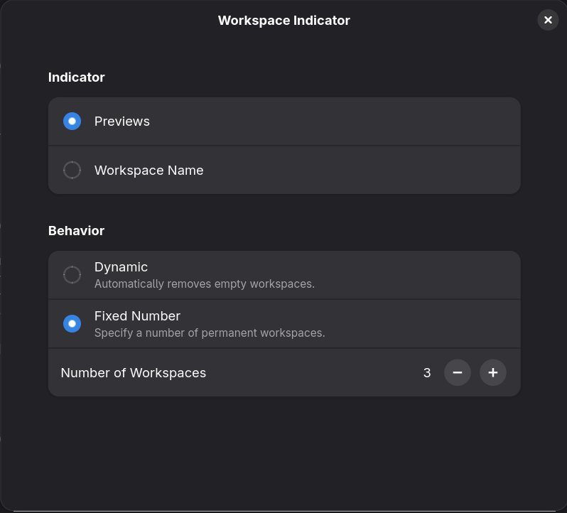

# Workspace Previews for GNOME

A restyled version of GNOME's Workspace Indicator extension that shows workspace previews in the top bar. Based on [gnome-shell-extensions](https://gitlab.gnome.org/GNOME/gnome-shell-extensions), licensed under GPL-2.0 (see COPYING).




If the stock Workspace Indicator is installed system-wide, this copy in your home folder takes priority.

Requires GNOME Shell 50.

<details><summary>Where it sits in the top bar</summary>


</details>

## Install

```bash
git clone https://github.com/voidrlm/gnome-workspace-previews.git ~/.local/share/gnome-shell/extensions/workspace-indicator@gnome-shell-extensions.gcampax.github.com
```

Log out and back in, then enable it:

```bash
gnome-extensions enable workspace-indicator@gnome-shell-extensions.gcampax.github.com
```

## Update

```bash
git -C ~/.local/share/gnome-shell/extensions/workspace-indicator@gnome-shell-extensions.gcampax.github.com pull
```

Then log out and back in.
